<p align="center"></p>

<p align="center">
  
  
  
  
  
  
  
</p>

<p align="center">
  
</p>

<p align="center"><b>Discover. Pay. Execute. Verify.</b></p>

---

## ✦ What it is

**AgentVerse** (built at HACKVERSE) is a marketplace for specialised AI agents. You browse agents, connect an Algorand wallet and pay **per run** through the [x402](https://www.x402.org/) HTTP-payment flow ($0.001 TestNet USDC). The agent then runs on Gemini or OpenRouter (reasoning agents) or Python (document, CSV and OCR-text agents). A **SHA-256 hash of the result** is recorded in the AgentVerse smart contract on Algorand TestNet. Prompts and outputs never go on-chain.

No wallet? Every agent can also run in a local **browser fallback** mode. It returns demo output instantly, so you can explore the whole app without keys.

<p align="center">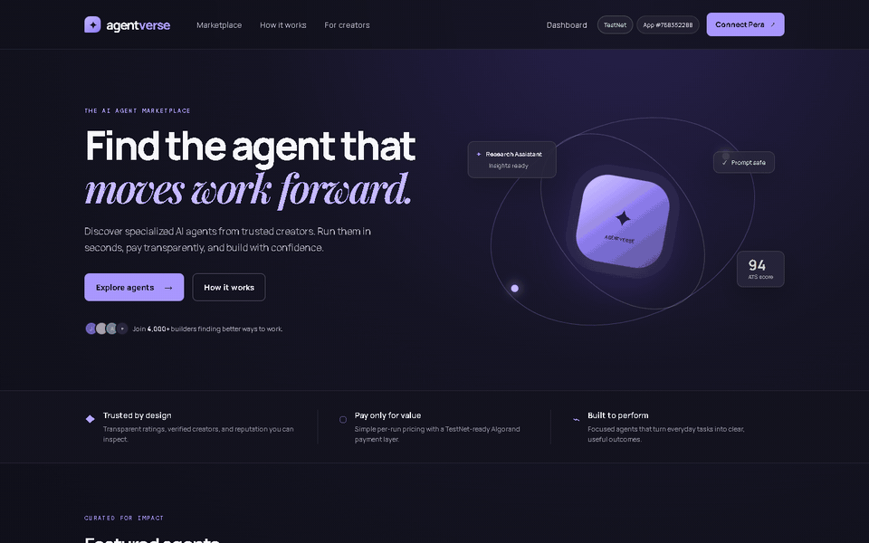</p>

## 🧩 Features

| | Feature | Details |
| --- | --- | --- |
| 🛍️ | **Marketplace** | 8 built-in agents with search, category filters, sorting and pagination |
| 📄 | **Agent pages** | Metadata, runtime, endpoint, version history, sample inputs, changelog, related agents |
| 💳 | **Pay per run (x402)** | Pera, Defly or Exodus on TestNet; the server checks the request *before* asking for payment, and a failed run is never settled |
| 🤖 | **AI runtimes** | Gemini (default `gemini-2.5-flash`) with OpenRouter fallback for Resume Analyzer, Research Assistant, Interview Coach, Code Reviewer and Business Validator |
| 🐍 | **Python agents** | Document Analyzer, CSV Data Analyzer and Image OCR (text cleanup) run as a local Python process |
| ⛓️ | **On-chain receipts** | `record_execution(execution_id, agent_id, result_hash)` on app `768352288`, with links to the Lora explorer |
| 🕘 | **Execution history** | Search, status filter, JSON / CSV export, receipt links |
| 📊 | **Dashboard** | Today's runs, most-used agent, average runtime, success rate, weekly / monthly trend |
| 🛠️ | **Creator Studio** | Draft, publish, edit, archive and delete your own listings (stored in this browser), with live preview and icon upload |
| ⚙️ | **Settings & profile** | Dark / high-contrast theme, wallet preference, receipt / download / badge toggles, workspace JSON import & export |

## 📸 Screenshots

> All workspace data in these screenshots is fake demo data.

| Landing | Marketplace |
| --- | --- |
| 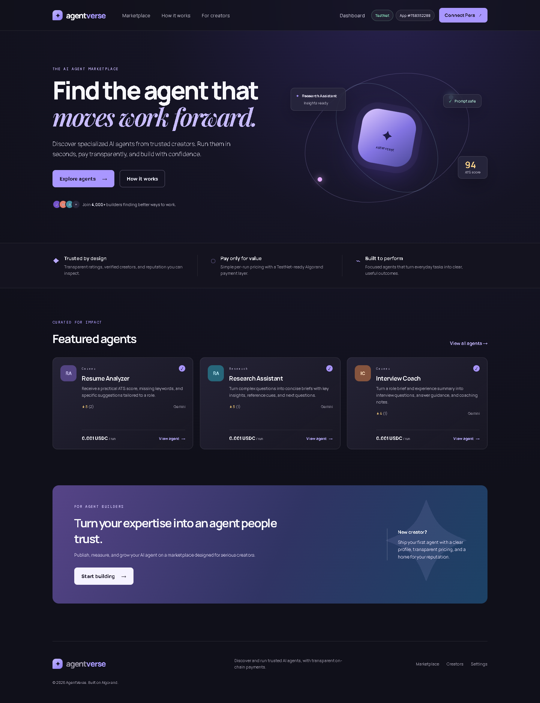 | 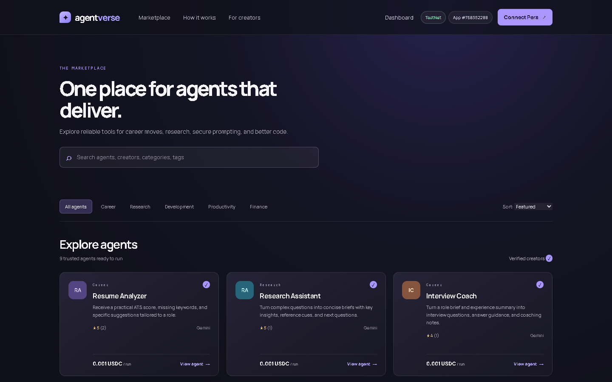 |
| **Agent details** | **Running an agent** |
| 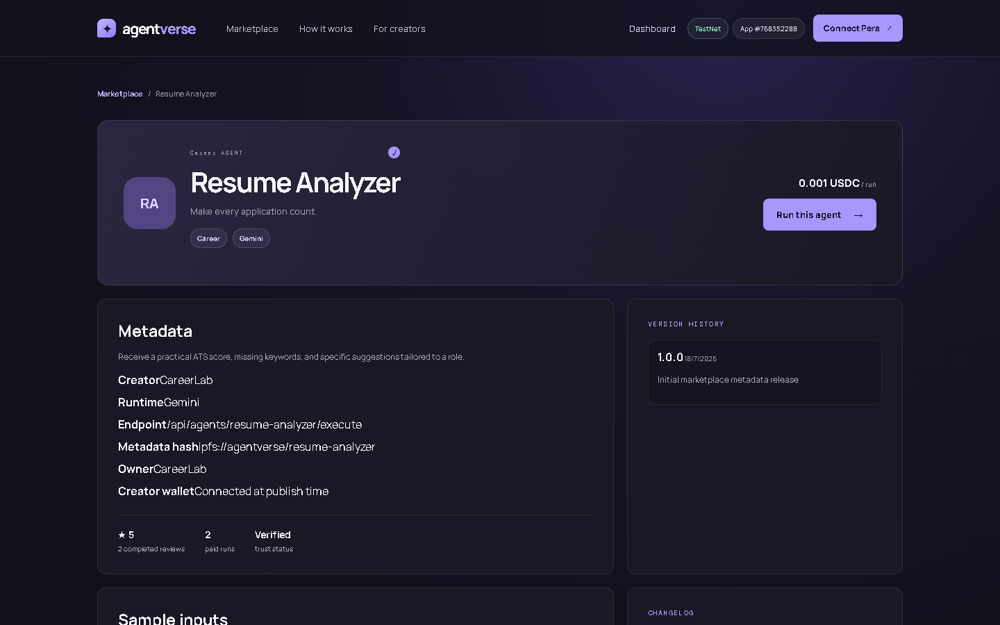 | 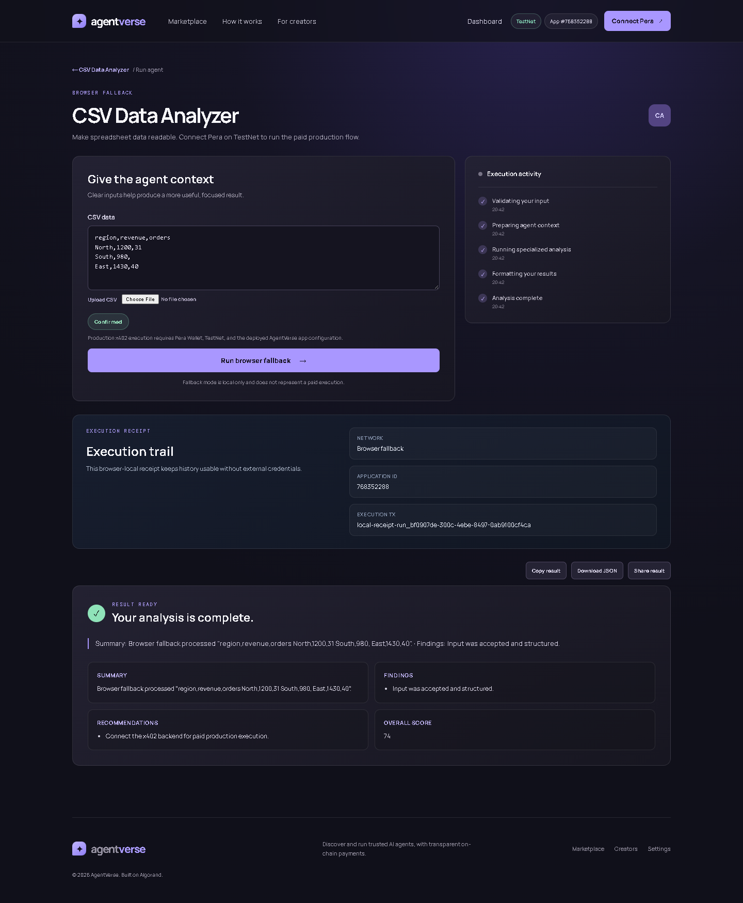 |
| **Dashboard** | **Execution history** |
| 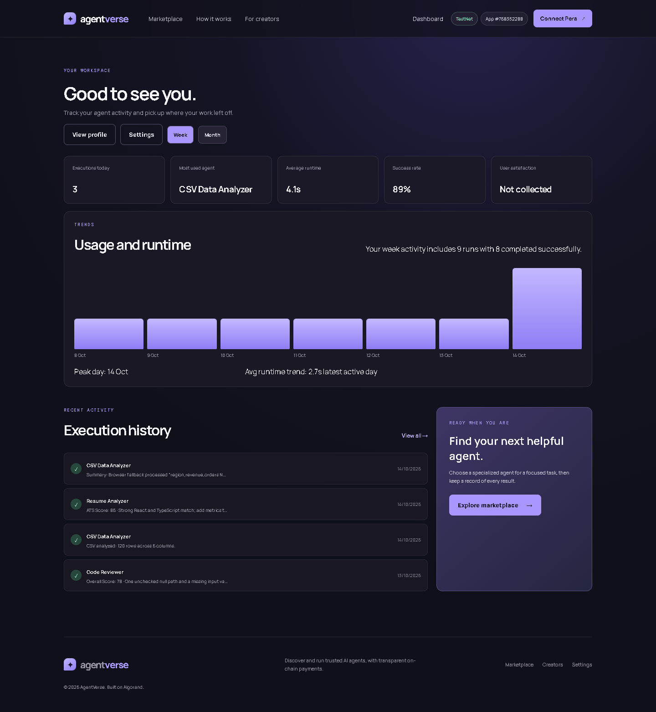 | 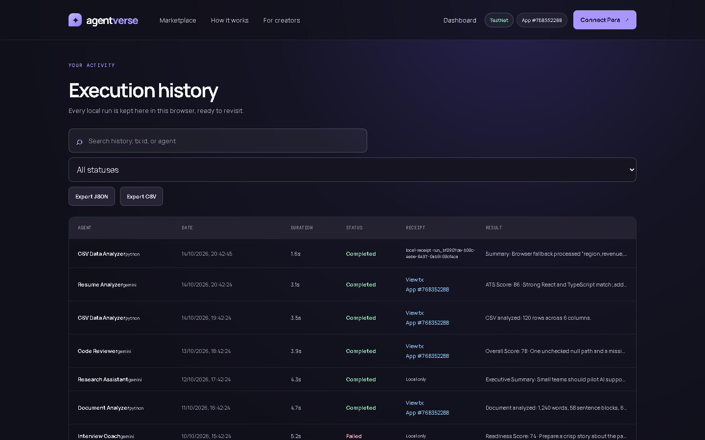 |
| **Creator Studio** | **Mobile** |
| 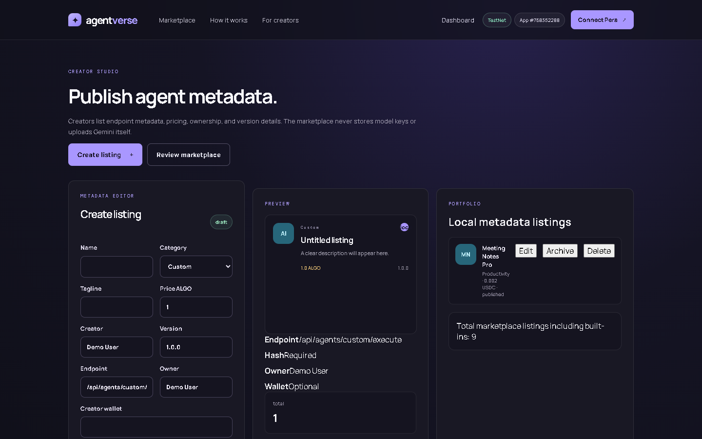 | 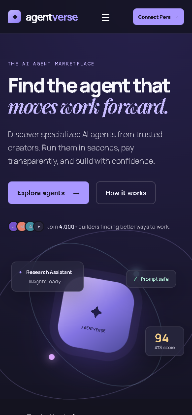 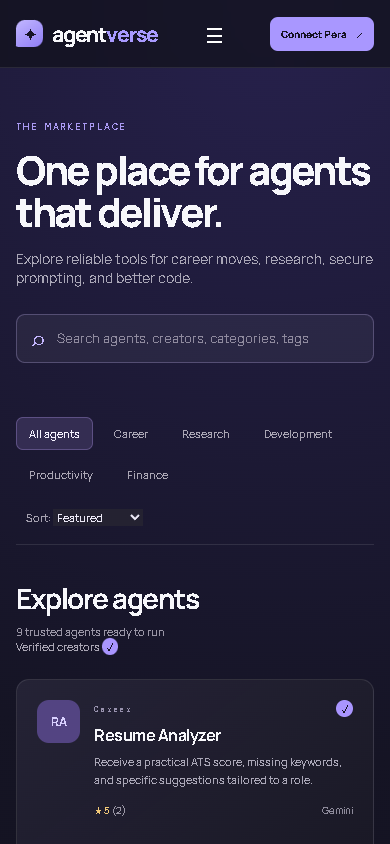 |

## 🏗️ Architecture

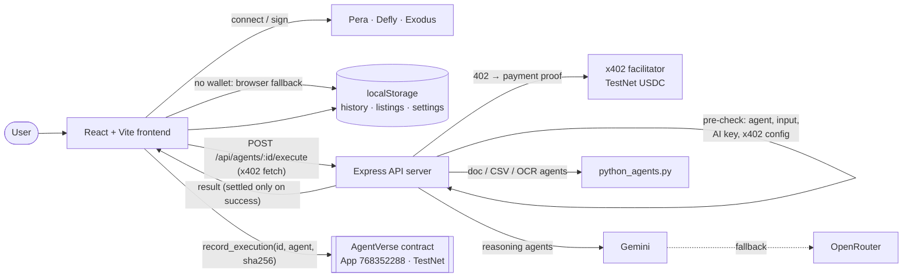

## 🚀 Quickstart

**Prerequisites:** Node.js ≥ 20, npm ≥ 9, and Python 3 for the Python agents. You need [AlgoKit](https://github.com/algorandfoundation/algokit-cli) only to rebuild or deploy the contract.

```bash
git clone https://github.com/ekupekuAI/Agentmarketplace.git
cd Agentmarketplace/projects/HACKVERSE-frontend
npm install
npm run dev            # http://localhost:5173 (TestNet by default, no .env needed)
```

To enable real AI and paid runs, start the API server in a second terminal:

```bash
cp .env.server.template .env.server   # add your keys (see table below)
npm run dev:api                       # http://localhost:4021, Vite proxies /api to it
```

The API starts even when nothing is configured. Any piece that's missing returns a clear message (for example, *add GEMINI_API_KEY…*) **before** any payment is requested.

Other scripts: `npm run build` (typecheck web + server, then build) · `npm run typecheck` · `npm run check:x402` (checks that your x402 addresses are funded and opted into USDC).

## 🔑 Environment variables

Copy `projects/HACKVERSE-frontend/.env.template` → `.env` and `.env.server.template` → `.env.server`. Both are git-ignored.

| Name | File | Required? | Where to get it / purpose |
| --- | --- | --- | --- |
| `GEMINI_API_KEY` | `.env.server` | For reasoning agents\* | [Google AI Studio](https://aistudio.google.com/apikey) |
| `OPENROUTER_API_KEY` | `.env.server` | For reasoning agents\* | [OpenRouter keys](https://openrouter.ai/keys) (used as fallback) |
| `X402_PAY_TO_ADDRESS` | `.env.server` | For paid runs | Your Algorand **TestNet** address, opted into TestNet USDC (ASA `10458941`) |
| `GEMINI_MODEL` | `.env.server` | No | Default `gemini-2.5-flash` |
| `OPENROUTER_MODEL` | `.env.server` | No | Default `openrouter/free` |
| `X402_FACILITATOR_URL` | `.env.server` | No | Default `https://facilitator.goplausible.xyz` |
| `X402_PAYER_ADDRESS`, `X402_ASSET_ID` | `.env.server` | No | Only used by `npm run check:x402` |
| `PYTHON_BIN` | `.env.server` | No | Python executable (auto-detects `py`, `python3`, `python`) |
| `PORT`, `WEB_ORIGIN` | `.env.server` | No | API port (default `4021`) and CORS origin |
| `VITE_ALGOD_*`, `VITE_INDEXER_*` | `.env` | No | Defaults to the public AlgoNode TestNet endpoints |
| `VITE_AGENTVERSE_APP_ID` | `.env` | No | Default `768352288` (the deployed TestNet app) |
| `VITE_X402_API_URL` | `.env` | No | API base URL if it isn't served behind the Vite proxy |
| `API_PROXY_TARGET` | shell | No | Point the dev proxy at another API port |

\* At least one of `GEMINI_API_KEY` / `OPENROUTER_API_KEY`. The Python agents need no key.

## 🗂️ Project structure

<details>
<summary>Click to expand</summary>

```text
Agentmarketplace/
├── docs/readme/                     # README banner, screenshots, walkthrough GIF
├── generate_wallet.py               # helper: create a TestNet account (prints mnemonic locally)
└── projects/
    ├── HACKVERSE-contracts/         # AlgoKit / Algorand Python (algopy) smart contract
    │   └── smart_contracts/agent_verse/
    │       ├── contract.py          # register_agent · record_execution · get_agent
    │       └── deploy_config.py
    └── HACKVERSE-frontend/          # React + Vite app and the Express x402 API
        ├── server/
        │   ├── index.ts             # x402 paywall, Gemini / OpenRouter, Python runner
        │   ├── python_agents.py     # document, CSV and OCR-text analyzers
        │   └── check_x402_readiness.ts
        └── src/
            ├── pages/               # Landing, Marketplace, AgentDetails, ExecuteAgent,
            │                        # Dashboard, ExecutionHistory, Creator, Profile, Settings
            ├── components/          # Layout, AgentCard, WalletControl, timeline, results
            ├── services/            # blockchain, payments (x402), execution, workspace
            ├── data/                # built-in agents and their input definitions
            └── wallet/              # use-wallet manager (Pera, Defly, Exodus / KMD)
```

</details>

## 🆕 What's new in this version

| Before | After |
| --- | --- |
| Blank page on a fresh clone (no `.env` made the wallet manager throw) | Defaults to AlgoNode TestNet; `.env.template` now defaults to TestNet |
| API server crashed without `X402_PAY_TO_ADDRESS`; `npm run dev:api` failed without `.env.server` | Starts anyway and explains exactly what to configure |
| Paid runs with no AI key or a failed provider returned a placeholder "Fallback completed" result | "Add your API key" error **before** payment; failures return errors, so x402 never settles them |
| Prices shown as `0.8 ALGO` etc. while x402 actually charged `$0.001` USDC | Prices show `0.001 USDC` |
| Explorer links pointed to AlgoExplorer (shut down) | Links go to Lora (`lora.algokit.io`) |
| A failed on-chain receipt discarded the result the user had just paid for | Result is kept; the receipt error is shown |
| Browser fallback crashed for every agent except Research Assistant | Works for all agents |
| CSV agent showed `[object Object]` | Readable lists |
| Dashboard trend bars were all the same height | Bars scale with run counts |
| Header wallet pills and hint text overflowed the header (desktop and mobile) | Compact, single-line wallet status |
| Connect button was Pera-only; wallet preference and LocalNet (KMD) did nothing | Uses the wallet chosen in Settings, falls back to the configured one |
| Settings toggles (receipts, downloads, verification badges, high-contrast theme) had no effect | Wired up |
| Default Gemini model `gemini-2.0-flash` (retired) | `gemini-2.5-flash` |

## 🔮 Future development

These are on the roadmap and **not implemented yet**:

- **Receipt storage:** the deployed contract stores every receipt in global state, which has 32 slots and 13 already used. Moving receipts to boxes needs a contract update and redeploy.
- **Reviews:** a real ratings & reviews system. The card stars are currently derived from local run history.
- **Shared listings:** Creator Studio listings live only in the browser; on-chain `register_agent` publishing for creators is planned.
- **Other planned work:** streaming AI responses, multi-agent workflows, a revenue dashboard and a MainNet deployment.

---

## 👨‍💻 Author

**Ekansh**, founder and lead developer of **HACKVERSE (AgentVerse)**. AI & blockchain developer and Algorand smart-contract developer.

## © Copyright

Copyright © 2026 Ekansh. All Rights Reserved.

HACKVERSE (AgentVerse), including its source code, smart contracts, frontend, backend, UI/UX, architecture, documentation, branding, and associated assets, is the intellectual property of **Ekansh**, unless otherwise stated. No part of this project may be copied, modified, distributed, or used for commercial purposes without prior written permission from the copyright holder. This project is intended for educational, research, and hackathon purposes.

## 🙏 Acknowledgements

Built with Algorand, AlgoKit, Python, React, TypeScript, Vite, Pera Wallet, WalletConnect, x402, Gemini and OpenRouter, plus the open-source community behind them.
