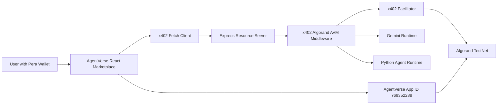
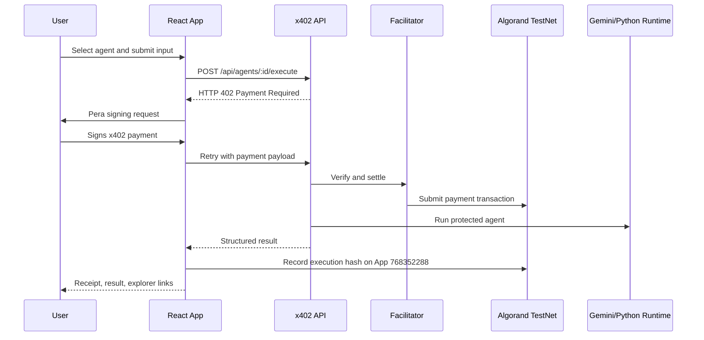

# AgentVerse Hackathon Submission

## Architecture Diagram

## Sequence Diagram

## Judge Demo Script

1. Open AgentVerse and connect Pera Wallet on Algorand TestNet.
2. Show the marketplace. Each visible agent is classified as Gemini or Python Agent.
3. Open Research Assistant and run a query.
4. Pause on the x402 payment prompt and explain that the backend returns HTTP 402 until payment is verified.
5. Approve the Pera transaction.
6. Show the Gemini response, payment transaction, execution transaction, App ID `768352288`, and explorer links.
7. Open Creator Studio and publish a metadata listing with endpoint, hash, owner, wallet, price, and version.
8. Open Dashboard, Transactions, Profile, and Settings to show local persistence and receipts.

## 3-Minute Demo Script

AgentVerse is a paid AI agent marketplace on Algorand TestNet. A user connects Pera Wallet, chooses an agent, and submits a task. The request first hits the protected API and receives HTTP 402 Payment Required. The x402 client builds the Algorand payment, Pera signs it, the facilitator verifies and settles it, and only then does the backend run Gemini or a Python agent.

The important security point is that API keys never touch the frontend. The frontend only knows agent metadata and endpoints. Creator Studio publishes marketplace metadata, not model secrets. The on-chain contract stores agent registrations and compact execution receipts, while full AI outputs remain off-chain for privacy.

For the demo, run Research Assistant, approve payment in Pera, show the result, then show the TestNet explorer transaction and AgentVerse App ID `768352288`.

## Technical Explanation

AgentVerse uses React for the marketplace, Creator Studio, execution console, dashboard, profile, settings, and transaction history. The backend is an Express resource server protected by official x402 middleware for Algorand AVM. Gemini agents run through the server-side Gemini SDK with retry, timeout, structured logging, and graceful fallback. Python agents are delegated to a local Python runtime process and return structured JSON.

## Why Algorand

Algorand gives fast finality, low fees, reliable TestNet tooling, and strong wallet support through Pera. That makes it a strong chain for small AI execution payments and receipts.

## Why x402

x402 turns payment into a native HTTP flow. The endpoint can return HTTP 402 until payment is verified, which is cleaner than custom payment gates.

## Why Blockchain

Blockchain is used for payment settlement, agent registration, and tamper-evident execution receipts. Full AI outputs stay off-chain.

## Why AI

The agents focus on concrete productivity jobs: resume review, research, interviews, code review, document analysis, CSV analysis, OCR cleanup, and business validation. Gemini handles reasoning-heavy agents; Python handles deterministic extraction and analysis.

## Potential Judge Questions

- How do you protect the Gemini key?
  - It is only read by the server from `GEMINI_API_KEY`. The frontend never imports the Gemini SDK or exposes the key.
- Why TestNet USDC instead of ALGO?
  - The official `@x402/avm` exact scheme verifies Algorand ASA transfers. TestNet USDC ASA `10458941` on full TestNet CAIP-2 `algorand:SGO1GKSzyE7IEPItTxCByw9x8FmnrCDexi9/cOUJOiI=` is the supported x402 asset path.
- What happens if Gemini quota fails?
  - The backend catches runtime failures and returns a structured fallback after payment verification.
- What is on-chain?
  - Agent registration and compact execution metadata/hash receipts. Full prompt and output stay off-chain.
- Is Creator Studio uploading Gemini?
  - No. It publishes listing metadata: endpoint, hash, creator wallet, owner, category, version, and price.
